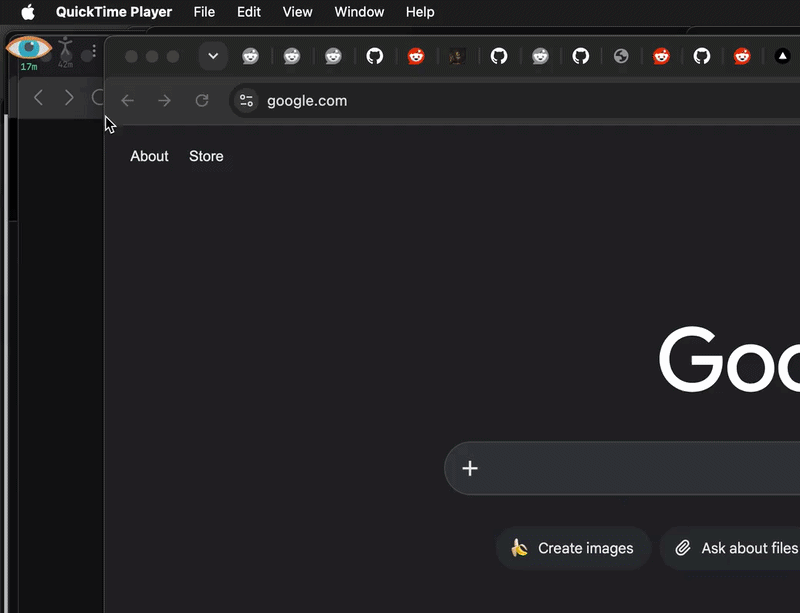

# Breaktime

A lightweight menu-bar-style app that reminds you to take screen breaks:
Shows an overlay eye that progressively closes until the break time happens, then 
plays a gentle sound to encourage breaking from the screen.

It also tracks physical stretch times so you can keep your body healthy in spite of 
computer time.



## Tech stack

- **Frontend:** SvelteKit 5 + Tailwind (static adapter, no SSR) in `app/`
- **Backend:** Tauri v2 (Rust) in `tauri/`
- **Plugins:** `tauri-plugin-idlemonitor` (system idle detection),
  `tauri-nspanel` (macOS floating overlay panel; Windows uses a plain
  transparent topmost window with tool-window styling — see `docs/ARCHITECTURE.md`)

## Development

Prerequisites: [bun](https://bun.sh) and a Rust toolchain (macOS or Windows).

```bash
bun install && cd app && bun install && cd ..     # install deps

bun run tauri:dev           # run the app in dev mode
bun run tauri:build         # build the app to deploy
```

Packaging: `bun run tauri:build` produces the app bundle from `tauri/target/`.

## Where data lives

- Settings & stats: `~/Library/Application Support/com.breaktime.app/.settings.json`
  (keys `settings` and `stats`)
- Window state: `~/Library/Application Support/com.breaktime.app/.breaktime_window.json`
  (positions are stored in **physical** pixels; sizes in logical points)

See `docs/ARCHITECTURE.md` for the full design, event catalog and persistence
schemas.
